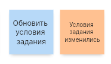
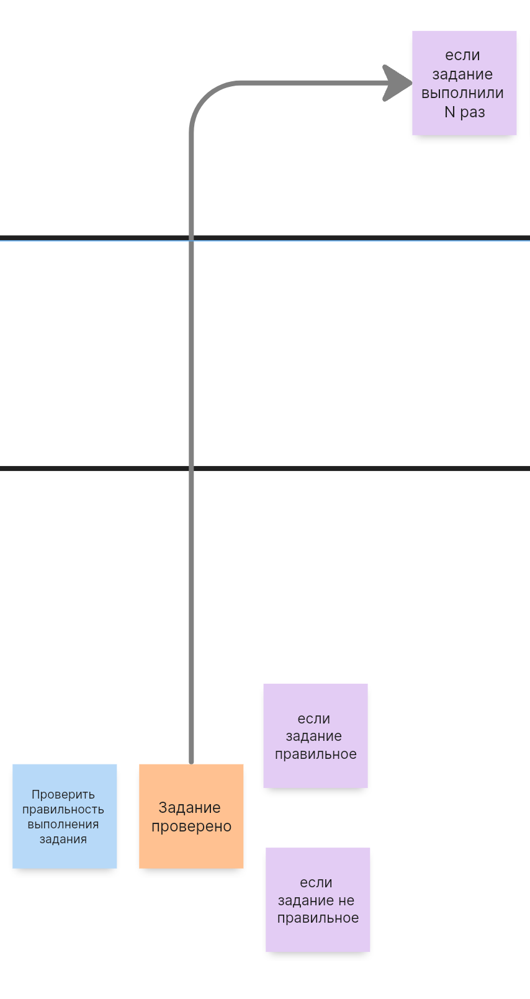

# Задание 2

## Взаимодействия систем

| Вид связи | Команда или событие<br>из EventStorming | Эндпоинт или событие<br>в коде | На вход | На выход |
| :--- | :--- | :--- | :--- | :--- |
| Синхронная HTTP | Обновление условий задания | `PUT /api/task/managing/update` | Идентификатор и обновлённые поля | Обновлённая сущность |
| Синхронная HTTP | Проверка задания | `/api/task/review` | Идентификатор задания и решение | Пользователю возвращается результат проверки; в базе сохраняется статус и увеличивается счётчик проверок |
| Асинхронная event-driven | Обновление условий задания | `UpdatedTaskMessage` | — | Тип «Сущность обновлена» и обновлённая сущность |
| Асинхронная event-driven | Проверка задания | `TaskReviewResultMessage` | — | Количество выполнений, результат проверки и данные задания |

## Обновление условий задания



## Проверка задания



#Задание 3

`[EVENT-010]`

```json
{
"event_name": "TaskRating",
"value": "completed"
}
```

- Сообщение не информативно
- Сообщение не говорит, что именно завершено 
- В идеале добавить идентификатор таски
- Название не совсем подходит, если тут речь про оценку задачи, то лучше изменить структуру на более развернутую, а если о результате выполнения, то лучше изменить на TaskResult 

`[EVENT-020]`

```json
{
"event_name": "Task",
"payload": {
"id": 1,
"rating": "0.04",
"name": "...",
"description": "...",
"author": { 
"id": 1,
"name": "Pavel",
"email": "...",
"role": "manager",
"created_at": "...",
}
"attempt_count": "",
"answers": [
{
"id": 1,
"text": "...",
"status":
"author": {
"id": 2,
"name": "Nick",
"email": "...",
"role": "maybe_teacher",
"created_at": "...",
}
},
...
],
"created_at": "...",
}
}
```
- Слишком много информации об авторе "author"
- В "answers" тоже избыточная информации об авторе
- Возможно стоит отказать от авторов в вопросах и таске, по идее у них и так должна быть связь и при необходимости получать их отдельно

# Задание 4 

| Номер связи | Как связь сделана на текущий момент             | Какая теперь будет связь                                 | Номера проблем бизнеса, которые потенциально решатся | Почему связь необходимо изменить                               |
| :--- |:------------------------------------------------|:---------------------------------------------------------| :--- |:---------------------------------------------------------------|
| `[COMM-040]` | HTTP-вызов Зачисление бонусов на счёт менеджера | Event в топик (Напрмер kafka)                            | [Problem-040] | Легче масштабировать нагрузку                                  |
| `[COMM-050]` | HTTP-вызов Списание средств со счёта менеджера  | Event в топик (Напрмер kafka)                            | [Problem-040] | Легче масштабировать нагрузку                                  |


# Задание 5

Для чата кафка не ок, потому что клиенты будут пользовать либо web-приложением, либо мобильным устройством(Android/IOS)
Ни web, ни mobile не умеют слушать топики кафка 
Но если на стороне фронта будет сделан пуллинг, а на бекенде кафка, то с оговоркой можно считать это взаимодействие через kafka

А если без оговорок, то наиболее универсальным будет websocket 
Для ios/android можно сделать grpc двунаправленные стримы 
